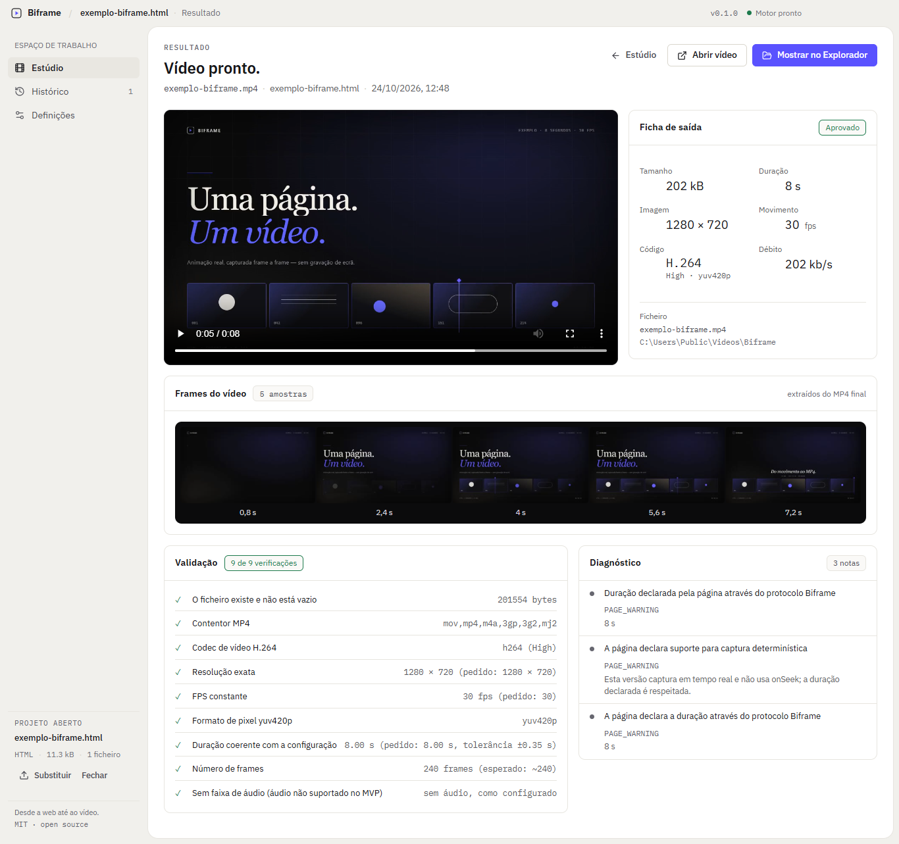

# Biframe

**Da web para vídeo.**

Biframe turns an animated HTML page into a validated H.264 MP4. It opens the page in a controlled Chromium at the exact output geometry, captures the compositor in real time, builds a constant-frame-rate sequence and lets FFmpeg encode it. No desktop recording, no timeline, no changes to the original file.


> Biframe 0.1 is a focused Windows desktop application. The interface is in Portuguese; the engine, the protocol and these documents are in English.

## Why it exists

Handing a client a video of an HTML animation usually means recording the screen, cropping it, discovering the timing is wrong and doing it again. Biframe makes the page itself the source of truth: it renders at **1280×720**, **1920×1080**, vertical or square, captures every compositor frame it can, resamples to a constant frame rate and refuses to call the result finished until `ffprobe` confirms the file.

- **Real frames, real progress.** Capture, resampling and encoding each report measured progress. Success is a validated file, not a progress bar that reached the end.
- **The page is treated as hostile.** Imported content runs sandboxed, without Node.js, from a tokenised loopback server, with private-network requests blocked.
- **Your file is never touched.** HTML files and ZIP projects are copied into a temporary workspace. The original path is only read.
- **A result you can inspect.** Every export reports codec, profile, pixel format, resolution, FPS, duration, bitrate, nine validation checks and five stills extracted from the final MP4.

## What it does

| Area | Supported |
| --- | --- |
| Input | Single `.html` / `.htm` / `.xhtml` with local assets, or a `.zip` project |
| Geometry | 720p (default), 1080p, 1440p, 4K, 1080×1920, 1080×1080, 1080×1350, custom even sizes up to 3840 |
| Motion | 24, 25, 30, 50 or 60 fps (60 default — matches the display the page is animated on) |
| Duration | Manual, or automatic through the optional [page protocol](docs/page-protocol.md) |
| Output | MP4, H.264 High profile, `yuv420p`, `+faststart`, AAC-free |
| Quality | CRF 26 / 21 / 17 with matching x264 presets |
| Review | Live preview at export geometry, diagnostics, real progress, cancel, overwrite confirmation, history, filmstrip from the encoded file |
| Interface | Portuguese (pt-PT), light and dark themes, keyboard shortcuts |

## What it is not (yet)

Biframe is honest about the boundary of version 0.1:

- **Not a deterministic renderer.** Capture is real time. Pages that need frame-perfect determinism should expose `window.biframe.duration`, but the engine still observes the animation as it plays. A future deterministic mode (`onSeek`) is reserved in the protocol and is not implemented.
- **No audio.** Video files embedded in the page are rendered visually; their audio is not muxed into the export.
- **No alpha channel.** H.264 `yuv420p` has no transparency.
- **No editing timeline, batch queue or trim marks.** The page is the timeline.
- **Windows is the tested platform.** The source is platform-neutral, but only the Windows x64 unpacked build has been packaged and smoke-tested. macOS and Linux builds are configured but unverified.
- **No code signing.** Windows SmartScreen may warn on an unsigned local build.

## Requirements

### Using a packaged build

- Windows 10 or 11, x64.
- No separate FFmpeg, FFprobe, Chromium or Playwright installation. The application ships its own.

### Building from source

- Node.js **22.12 or newer** (verified with Node 26.10).
- npm 11 or newer.
- Windows 10/11 for the tested packaging path.
- Network access during `npm install` (Electron, FFmpeg and FFprobe binaries are downloaded by their packages).

## Run from source

```bash
cd biframe
npm install
npm run dev
```

The development window uses Electron's own Chromium. Playwright is used as a driver for end-to-end tests; it does not download a separate browser.

## Build

```bash
npm run build          # typecheck + production bundles in out/
npm run build:unpack   # unpacked application in release/win-unpacked/
npm run build:win      # NSIS installer (not yet verified)
```

The verified Windows artifact is the unpacked build:

```text
release/win-unpacked/Biframe.exe
release/win-unpacked/resources/example/exemplo-biframe.html
release/win-unpacked/resources/app.asar.unpacked/node_modules/ffmpeg-static/ffmpeg.exe
release/win-unpacked/resources/app.asar.unpacked/node_modules/ffprobe-static/bin/win32/x64/ffprobe.exe
```

Run the packaged smoke test after `npm run build:unpack`:

```bash
node scripts/dev/smoke-package.mjs
```

It launches `Biframe.exe`, imports the packaged example, exports a 720p clip and probes the result with the bundled `ffprobe`.

## A first export

1. Choose **Importar HTML**, **Importar ZIP**, drag a file onto the window, or press **Abrir exemplo**.
2. Set the file name, destination, resolution, frame rate and duration in the export panel. The live preview is laid out at the export geometry and scaled to fit — it is not a decorative mock-up.
3. Press **Exportar vídeo**. The page reloads, capture starts at the first observable animation activity, frames are written to disk, resampled to CFR, encoded by FFmpeg and probed.
4. On the result screen, inspect the output card and the five frames extracted from the MP4. **Abrir vídeo** plays the file; **Mostrar no Explorador** reveals it.

If a file with the same name exists, Biframe asks before replacing it. Importing and closing are blocked while a render is running; a second render is rejected with `RENDER_IN_PROGRESS` instead of being silently queued.



The sheet above is the real outcome of the bundled example in automatic-duration mode: the page declared 8 seconds, Biframe captured 480 frames at 60 fps, FFmpeg encoded H.264 High with `yuv420p`, and `ffprobe` passed all nine checks. The five stills at the bottom are extracted from the encoded file, not from the live page. The Diagnóstico section shows what the session really delivered (49.2 fps on that run, with the count of repeated frames) instead of hiding it.

## How it works

```text
React renderer
   │  typed IPC through a context-isolated preload
   ▼
Electron main process
   ├─ ProjectService     copy / extract → loopback HTTP server with a random token
   ├─ PreviewService     WebContentsView at export geometry, shared locked-down session
   ├─ RenderService      one job at a time, real progress, cancellation
   └─ engine (no Electron imports)
        ├─ ElectronCaptureHost   off-desktop Chromium (native compositor) + CDP Page.startScreencast (JPEG)
        ├─ FrameStore            timestamped frames on disk
        ├─ frame-plan            nearest-frame resampling to exact CFR
        ├─ FFmpeg                libx264, High profile, yuv420p, faststart
        └─ ffprobe               nine checks, diagnostics, five poster stills
```

The renderer never receives a filesystem path it can open. Media is served through a custom `biframe-media://` protocol that resolves opaque IDs against the application's own records and supports HTTP Range requests for seeking.

Read [docs/architecture.md](docs/architecture.md) for the process model and [docs/rendering-engine.md](docs/rendering-engine.md) for the pipeline in detail.

## Security in one paragraph

Imported projects are untrusted. They run in sandboxed renderers with `nodeIntegration: false`, `contextIsolation: true`, no preload and no webviews. They are served from `127.0.0.1` behind a per-import random token, never from `file://`. ZIP entries are validated against traversal, absolute paths, drive letters, NTFS alternate data streams, control characters, trailing dots/spaces and symlinks before anything is written. Navigation is restricted to the project origin; window opens, downloads, permissions and private-network requests are blocked. Remote fonts, images and scripts are opt-in, and every remote host is DNS-checked to prevent SSRF. See [SECURITY.md](SECURITY.md) and [docs/adr/0002-untrusted-content-boundary.md](docs/adr/0002-untrusted-content-boundary.md).

## Optional page protocol

A page can help the engine without depending on it:

```html
<script>
  window.biframe = { duration: 36.5, ready: true };
  // …animation…
  window.addEventListener('animationend', () => {
    window.dispatchEvent(new CustomEvent('biframe:complete'));
  });
</script>
```

`duration` enables **Duração: Automática** without a completion signal. Dispatching `biframe:complete` ends an automatic capture. A page that uses neither still works with a manual duration. The protocol is optional, additive and never injected into the imported file. Full reference: [docs/page-protocol.md](docs/page-protocol.md).

## Tests

```bash
npm run lint
npm run typecheck
npm run test:unit          # pure logic, no Electron
npx vitest run --project ui
npm run test:integration   # real FFmpeg/FFprobe, fake capture host, real loopback server
npm run test:e2e           # real Electron app through Playwright
```

The end-to-end project builds the application once unless `BIFRAME_SKIP_E2E_BUILD=1` is set. Tests write only under `.test-out/`. A short summary of what each layer proves is in [docs/testing.md](docs/testing.md).

The acceptance case used during development is a five-scene, 36.5-second 1280×720 page. The final verified run exported 1,095 frames, H.264 High, `yuv420p`, 1,786,764 bytes, with nine of nine validation checks passing; frames from all five scenes were visually inspected and the original HTML kept the same size and SHA-256. The bundled `resources/example/exemplo-biframe.html` is a smaller offline example that ships with the app.

## Project layout

```text
src/
  engine/        Electron-free rendering engine (capture contract, frames, FFmpeg, validation)
  main/          Electron composition root: windows, IPC, services, protocols, security policy
  preload/       the only bridge exposed to the interface
  renderer/      React 19 interface, styles and screens
  shared/        neutral types, schemas, errors, presets, formatting
tests/
  unit/          pure functions and stores
  integration/   real binaries, fake capture host, HTTP server, project import
  e2e/           real Electron application and real exports
  ui/            React Testing Library
docs/            architecture, engine, protocol, tests, security, ADRs
resources/       bundled offline example
build/           generated application icons
scripts/         icon generation, development and packaged smoke harnesses
```

## Limits and defaults

| Limit | Default |
| --- | --- |
| Project size | 500 MB |
| ZIP entries | 5,000 |
| Longest capture | 600 s |
| Page load timeout | 60 s |
| Concurrent renders | 1 |
| Poster sets retained | 20 |
| Render jobs retained in memory | 20 |

Custom dimensions must be even and between 64 and 3840 pixels. Durations must be at least 0.5 s. These are enforced by Zod schemas in the main process and again at the engine boundary.

## Troubleshooting

- **A remote font or image is missing.** Enable **Permitir recursos externos** in Definições. Private, loopback and metadata addresses remain blocked by design.
- **The page is blank in preview but the file exists.** The preview is suspended when the stage is scrolled out of view; scroll back to it or press **Recarregar**.
- **The export says the page never signalled completion.** Use a manual duration, or add `window.biframe.duration` / the `biframe:complete` event.
- **Some assets built by JavaScript are missing after importing a single HTML file.** A static scan cannot follow runtime-constructed paths. Import the project as a ZIP instead.
- **The result has duplicated frames.** The compositor delivered fewer frames than the requested FPS; below 90 % of the request Biframe reports `CAPTURE_RATE_LOW` and repeats the nearest frame rather than stretching time. 60 fps is the default because it matches the display, but a heavy page on a slow machine may realistically deliver less.
- **Logs.** Definições → **Registos** opens the log directory.

## Contributing, security, licence

- [CONTRIBUTING.md](CONTRIBUTING.md) — setup, architectural rules, test expectations.
- [SECURITY.md](SECURITY.md) — supported versions and private reporting.
- [docs/security.md](docs/security.md) — threat model, controls and residual risks.
- [THIRD_PARTY_NOTICES.md](THIRD_PARTY_NOTICES.md) — bundled FFmpeg/FFprobe and other dependencies.
- [LICENSE](LICENSE) — MIT for Biframe's own source.

Biframe bundles [FFmpeg](https://ffmpeg.org/) via `ffmpeg-static` and `ffprobe-static`, uses [Electron](https://www.electronjs.org/), [Chromium](https://www.chromium.org/), [React](https://react.dev/), [Vite](https://vite.dev/) and [Playwright](https://playwright.dev/), and sets its interface in IBM Plex Sans and IBM Plex Mono. Their licences remain their own; see the dependency licences in `node_modules` and the FFmpeg build information reported in Definições.
